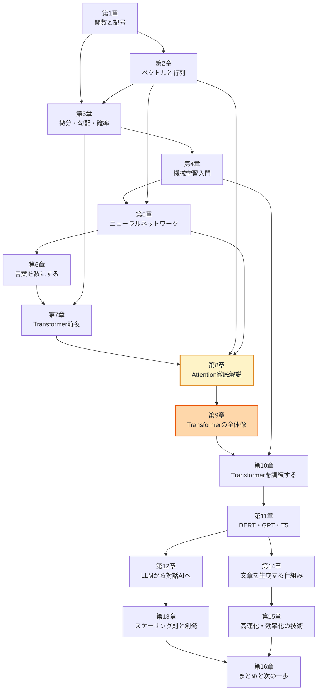

# ゼロから理解するTransformer — 基礎から学ぶLLMの仕組み

本書は、ChatGPTなどの大規模言語モデル（LLM）の中核技術である **Transformer** の仕組みを、数学や機械学習の専門的な前提知識がなくても理解できるように解説したテキストです。

---

## 本書の特徴

多くの解説で省略されがちな前提の数学や基礎理論から、順を追って説明しています。

- **数学の基礎から**: ベクトル、行列、微分、確率などを、文系の高校数学を前提に説明します。
- **数式の読み方と計算例**: 数式には日本語の読み方を添え、具体的な数値で手計算する例を載せています。
- **図による説明**: モデルの構造やデータの流れを図で示しています。

---

## 知識のロードマップ

各章は、それより前の章で学んだ内容を使います。章どうしのつながりは次の図のとおりです。

---

## 目次

### 第I部 基礎編 — 数学と機械学習の土台

| 章 | タイトル | 主な内容 |
|---|---|---|
| [第1章](01-functions-and-symbols.md) | 数学の準備(1) — 関数と記号に慣れる | 関数 $f(x)$ 、指数・対数、 $\Sigma$ 記法 |
| [第2章](02-vectors-and-matrices.md) | 数学の準備(2) — ベクトルと行列 | ベクトル、内積（類似度）、行列積 |
| [第3章](03-derivatives-gradients-probability.md) | 数学の準備(3) — 微分・勾配・確率 | 微分、勾配降下法、確率分布の基礎 |
| [第4章](04-machine-learning-basics.md) | 機械学習入門 — データから学ぶとはどういうことか | 損失関数、最適化、過学習とその対策 |
| [第5章](05-neural-networks.md) | ニューラルネットワーク — 脳を模した計算の仕組み | 層の構造、活性化関数、Softmax、交差エントロピー |

### 第II部 入門編 — 言語の数値化とTransformer

| 章 | タイトル | 主な内容 |
|---|---|---|
| [第6章](06-words-to-numbers.md) | 言葉を数にする — トークンと埋め込み | トークン化、単語の埋め込みベクトル |
| [第7章](07-before-transformer.md) | Transformer前夜 — RNNの栄光と限界 | 言語モデルの歴史、RNN、seq2seq、Attentionの萌芽 |
| [第8章](08-attention.md) | Attention徹底解説 — 本書の山場 | Query/Key/Value、Self-Attention、Multi-Head Attention |
| [第9章](09-transformer-architecture.md) | Transformerの全体像 | 位置エンコーディング、残差接続、LayerNorm、FFN |

### 第III部 応用編 — LLMへの発展と最新技術

| 章 | タイトル | 主な内容 |
|---|---|---|
| [第10章](10-training.md) | Transformerを訓練する | 自己教師あり学習、次単語予測、パープレキシティ |
| [第11章](11-bert-gpt-t5.md) | 三つの系譜 — BERT・GPT・T5 | エンコーダ型、デコーダ型、エンコーダ・デコーダ型 |
| [第12章](12-from-llm-to-chat-ai.md) | LLMから対話AIへ — 微調整とRLHF | 指示チューニング、RLHF、DPO |
| [第13章](13-scaling-laws.md) | スケーリング則と創発 | 計算量と精度の関係、創発的能力 |
| [第14章](14-text-generation.md) | 文章を生成する仕組み | 自己回帰生成、サンプリング戦略（Temperature, Top-p） |
| [第15章](15-efficiency.md) | 高速化・効率化の技術 | KVキャッシュ、量子化、LoRA、MoE |
| [第16章](16-conclusion-and-next-steps.md) | まとめと次の一歩 + 用語集 | 全体の振り返り、よくある疑問、今後の学習指針 |

---

## 読み進め方の目安

- **初学者の方**: 第1章から順に読み進めることを推奨します。各章で登場する概念が以降の章の土台となります。
- **数学（線形代数・微積分）の基礎がある方**: 第1〜3章を軽く確認したうえで、第4章（機械学習入門）または第6章（言葉を数にする）から読み始めても構いません。
- **Attention機構を重点的に学びたい方**: 第8章・第9章がTransformerの核心部です。必要に応じて第2章（内積）や第5章（Softmax）を参照してください。
